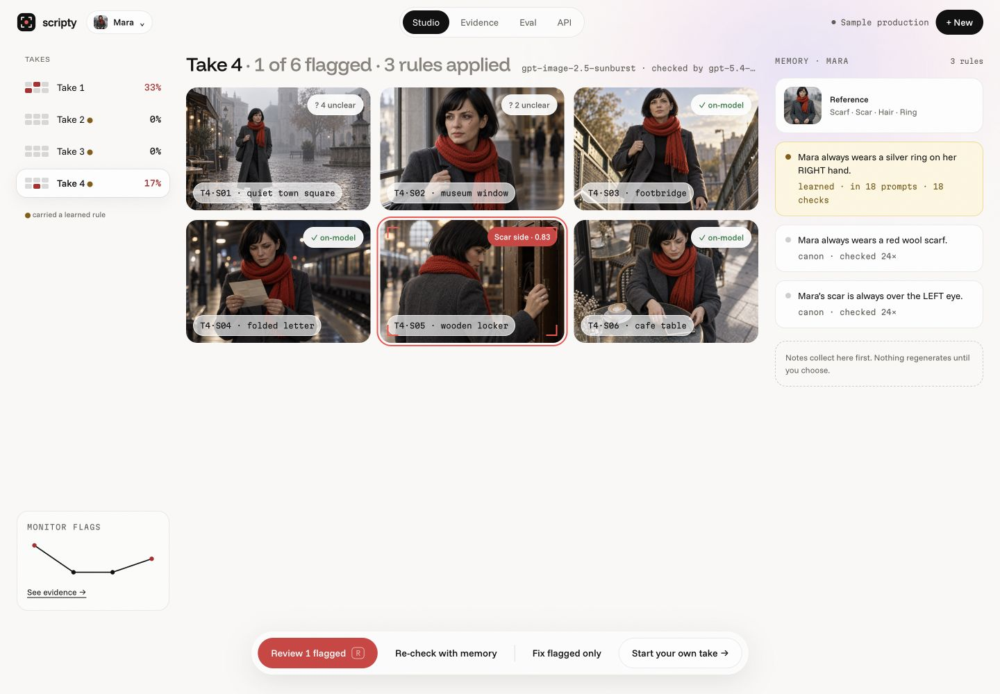
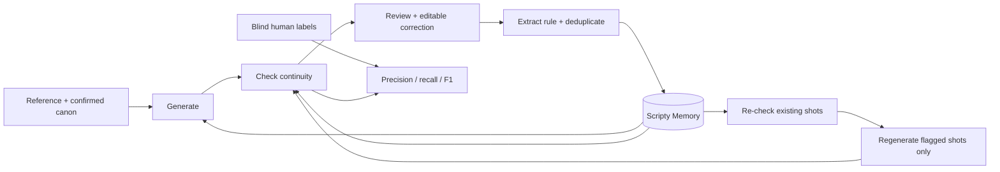

# Scripty

**Scripty: the AI script supervisor. Every correction carries forward.**

[Open Scripty](https://canon-woad.vercel.app/) · Video: coming soon

[](https://github.com/alexandrajcowan275/canon/actions/workflows/ci.yml)



## The problem

An image generator can return success while a character's ring changes hands or a scar changes sides. Filmmakers catch the slip, correct the prompt, then repeat that correction on the next shot. Scripty gives AI productions a script supervisor's memory: check the shot, capture the correction, carry it forward.

## Try it in 30 seconds

Open **Sample production: Mara** for24real images, four takes and the full saved learning history. Review a shot with its reference, edit a rejection note, and watch the constraint become Scripty Memory. **Start a new production** adds your own reference, confirmed canon and scenes; authorized live actions generate, check, learn and regenerate.

## How it works



## Why it is continual learning

Each creator correction becomes persistent, inspectable production memory. The same rule reaches later generation prompts and vision checks across new scenes; repeated constraints merge instead of accumulating duplicates. Human disagreements can also guide later inspection, while evaluation preserves frozen predictions. The goal is less drift over time. Today the demonstrated result is memory and prompt adaptation through usage; foundation-model weights stay fixed.

## Results

**Controlled A/B:0/6 targeted-attribute flagged shots with canon only,0/6 with canon + learned memory.** The fixed checker found0/12 ring/scar failures and0/24 overall failures in each arm, with no uncertain checks. Adding the learned ring rule produced no additional reduction in this six-pair test; canon-only generation already passed the rubric. These are monitor judgments, pending human blind validation. The run cost an estimated **$0.710364** from returned usage.

The original production history remains available:

| Take | Monitor-flagged shots | Uncertain checks |
| --- | --- | --- |
| 1 | 2/6 | 4/36 |
| 2 | 0/6 | 6/42 |
| 3 | 0/6 | 8/42 |
| 4 | 1/6 | 6/42 |

**18/18 rule reach:** one learned ring correction reached all 18 later image prompts and corresponding monitor outputs. These four takes changed models/settings, scenes, references and monitoring requirements, so their flag curve does not establish causal visual improvement. A real live-loop verification also preserved a repair that remained flagged. Checker accuracy comes only from actual blind human judgments; agent-written drafts never count.

[Full measurements and limitations](docs/results.md) · [Experiment artifacts](seed/experiments/ab-test/).

## Stack

| Layer | Technology |
| --- | --- |
| Application and API | Next.js App Router, React, TypeScript |
| Data and images | Supabase Postgres + Storage; bundled Mara assets |
| Reference-conditioned generation | OpenAI GPT Image 2.5 Sunburst |
| Structured continuity monitor | OpenAI GPT-5.4 mini + Zod |
| Rule extraction and deduplication | GPT-4.1 mini + transactional memory writes |
| Deployment and checks | Vercel + GitHub Actions |
| Optional location experiment | World Labs Marble; reviewed still + external world |

## API and architecture

Generate batches, submit editable reviews, inspect production memory, re-check existing shots, repair flagged shots and evaluate human labels. Paid actions require server-side authorization, ownership and rate/cost limits.

[API reference](docs/api.md) · [Architecture, data model and security](ARCHITECTURE.md).

## Run locally

With dependencies/configuration already installed:

```sh
cd ~/canon && npm run dev
```

Open http://localhost:3000. For a new checkout, use Node24, run `npm ci`, copy `.env.example` to `.env.local`, then `npm run dev`. Mara's sample needs no AI credentials. [Live access and operations](docs/operations.md).

```sh
npm run typecheck
npm test
npm run build
```

## How we built it

We used a multi-agent Codex workflow with explicit folder ownership: Main coordinated backend, persistence, evidence, docs and releases; Design owned pages, components, styles and public assets. Claude supplied product-design direction and the [HTML prototype and handoff](docs/design-sources.md). Independent evaluation and QA reviews identified issues; Main integrated safe fixes and verified releases before deployment. Shared contracts and isolated branches let design and engine work advance together while preserving the working sample.

[Design decisions](DECISIONS.md) · [Devpost write-up](docs/devpost.md) · [Video script](docs/video-script.md) · [MIT license](LICENSE).
