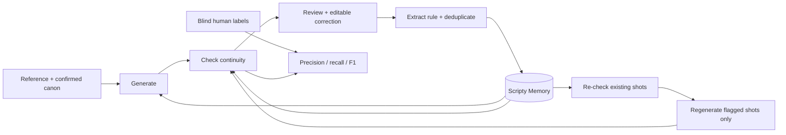

# Scripty

**Scripty: the AI script supervisor. Every correction carries forward.**

[Open Scripty](https://getscripty.vercel.app/) · Video: coming soon

[](https://github.com/alexandrajcowan275/scripty/actions/workflows/ci.yml)


## The problem

An image generator can return success while a character's ring changes hands or a scar changes sides. Filmmakers catch the slip, correct the prompt, then repeat that correction on the next shot. Scripty gives AI productions a script supervisor's memory: check the shot, capture the correction, carry it forward.

## Who it is for and the gap we are testing

Our initial customer hypothesis is a small AI production team making recurring characters for advertisements, storyboards or episodic stories. The recurring task is keeping characters consistent across scenes while recording and reusing creator decisions.

The gap we are testing is the connection between a correction and subsequent work: a review note should stay attached to the production, become an inspectable constraint, reach future generation prompts and checks, and retain a trace to its source. Scripty connects those steps. This is a product hypothesis, not a verified claim that competing tools lack continuity, references or memory. Willingness to pay and competitive advantage remain unvalidated.

## Why now

AI tools are moving into established filmmaking workflows. In June 2026, [Runway and Lionsgate announced an expanded partnership](https://runway.com/news/company-news/runway-and-lionsgate-expand-partnership), including a planned short-form episodic series using Lionsgate IP and Runway models. This supports the relevance of AI production workflows; it does not establish demand or a market-size estimate for Scripty.

Our proposed opportunity is production-specific review and memory as teams create more shots and revisions. Creator pilots must establish whether carrying decisions forward saves work.

## Current product scope

A creator starts a production, uploads a PNG, JPEG or WebP character reference, confirms the details that must stay consistent, and enters one scene prompt per line for one to six shots. Generation happens inside Scripty through an image-generation service. A separate monitor checks the images and presents findings for creator review. Live AI actions require the private access code and available budget.

The prototype supports editable review notes, deduplicated memory, later prompt/check application, monitor-only rechecks and flagged-shot replacement preserving original-image lineage. Mara offers recorded history without waiting for generation. Visitor sample notes stay in that browser and do not change the historical images or evidence.

Uploading finished videos for analysis, temporal video checking, team collaboration and cross-provider continuity are outside this release. The optional World Labs location still is a reference experiment, not a demonstrated location-checking or video pipeline.

## Try it in 30 seconds

1. Open [Scripty](https://getscripty.vercel.app/) and choose **Open the studio** in the hero, or use [Home](https://getscripty.vercel.app/dashboard) to open Mara from the productions table.
2. In **Take4**, select **T4·S05**, the locker shot. Inspect the monitor finding and edit the continuity note.
3. Choose **Reject & remember**. The **Rule learned** card shows the returned rule and its next-prompt/check previews. Repeated notes merge.
4. Open **Evidence** for24original images, all four takes,18/18rule reach and the matched six-pair result.

Mara is a sample production with real recorded history. Visitor notes stay in that browser and leave original images and evidence unchanged. [Start a production](https://getscripty.vercel.app/new) to add your own reference, confirmed canon and scenes; live AI actions require authorized access and budget. The current release generates still images. Video continuity and broader generator integrations are roadmap work.

## How it works



## Why it is continual learning

Each creator correction becomes persistent, inspectable production memory. The same rule reaches later generation prompts and vision checks across new scenes; repeated constraints merge instead of accumulating duplicates. Human disagreements can also guide later inspection, while evaluation preserves frozen predictions. The goal is less drift over time. Today the demonstrated result is memory and prompt adaptation through usage; foundation-model weights stay fixed.

## Results

**Controlled A/B: 0/6 targeted-attribute flagged shots with canon only, 0/6 with canon + learned memory.** The fixed checker found 0/12 ring/scar failures and 0/24 overall failures in each arm, with no uncertain checks. Adding the learned ring rule produced no additional reduction in this six-pair test; canon-only generation already passed the rubric. These are monitor judgments, pending human blind validation. The run cost an estimated **$0.710364** from returned usage.

The original production history remains available:

| Take | Monitor-flagged shots | Uncertain checks |
| --- | --- | --- |
| 1 | 2/6 | 4/36 |
| 2 | 0/6 | 6/42 |
| 3 | 0/6 | 8/42 |
| 4 | 1/6 | 6/42 |

**18/18 rule reach:** one learned ring correction reached all 18 later image prompts and corresponding monitor outputs. These four takes changed models/settings, scenes, references and monitoring requirements, so their flag curve does not establish causal visual improvement. A real live-loop verification also preserved a repair that remained flagged. Checker accuracy comes only from actual blind human judgments; agent-written drafts never count.

[Full measurements and limitations](docs/results.md) · [Experiment artifacts](seed/experiments/ab-test/).

## Business hypothesis and next steps

We would test review seats plus checked-generation usage as a pricing model. No price, paying customer or savings figure is validated. A first pilot would measure reviewer minutes, total generation/checking cost per human-approved shot, repeated-error frequency and willingness to pay under a consistent review standard. Costs must include failed attempts and human review.

Next priorities are creator pilots and human-reviewed evaluation, followed by temporal video continuity and additional generator integrations. A possible later product is a continuity API carrying customer-approved production memory into other tools. These are plans, not shipped capabilities. TAM and SAM remain unestimated; defensible sizing requires a defined buyer population and plausible annual spending assumptions.

## Stack

| Layer | Technology |
| --- | --- |
| Application and API | Next.js App Router, React, TypeScript |
| Data and images | Supabase Postgres + Storage; bundled Mara assets |
| Reference-conditioned generation | OpenAI GPT Image 2.5 Sunburst |
| Structured continuity monitor | OpenAI GPT-5.4 mini + Zod |
| Rule extraction and deduplication | GPT-4.1 mini + transactional memory writes |
| Deployment and checks | Vercel + GitHub Actions |
| Optional location experiment | World Labs Marble; captured still + private Marble world |

## API and architecture

Generate batches, submit editable reviews, inspect production memory, re-check existing shots, repair flagged shots and evaluate human labels. Paid actions require server-side authorization, ownership and rate/cost limits.

[API reference](docs/api.md) · [Architecture, data model and security](ARCHITECTURE.md).

## Run locally

With dependencies/configuration already installed:

```sh
cd ~/canon && npm run dev
```

Open http://localhost:3000. For a new checkout, use Node24, run `npm ci`, copy `.env.example` to `.env.local`, then `npm run dev`. Mara's sample needs no AI credentials. [Live access and operations](docs/operations.md).

```sh
npm run typecheck
npm test
npm run build
```

## How we built it

We used a multi-agent Codex workflow with explicit folder ownership: Main coordinated backend, persistence, evidence, docs and releases; Design owned pages, components, styles and public assets. Claude supplied product-design direction and the [HTML prototype and handoff](docs/design-sources.md). Independent evaluation and QA reviews identified issues; Main integrated safe fixes and verified releases before deployment. Shared contracts and isolated branches let design and engine work advance together while preserving the working sample.

[Design decisions](DECISIONS.md) · [Devpost write-up](docs/devpost.md) · [Video script](docs/video-script.md) · [MIT license](LICENSE).
