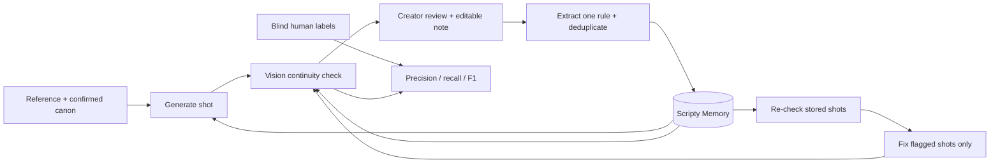

# Scripty

```sh
cd ~/canon && npm run dev
```

Open **http://localhost:3000**. Public app: [Scripty](https://canon-woad.vercel.app/). [Current release and two-minute walkthrough](handoff/MORNING.md).

**Your AI script supervisor. Every correction carries forward.**

In 30 seconds: an image generator can return success while a costume, prop or scar changes. Scripty checks each shot against a character reference and production canon. A creator edits a rejection note; Scripty extracts and deduplicates a rule, remembers it, and adds it to later image prompts **and** vision checks. Re-check an existing shot without generating an image, or regenerate only the shots the monitor flags.

## Try it

- **Sample production: Mara** opens four original takes and 24 real images with prompts, checks, memory and traces. It needs no AI call. New sample notes belong to your browser; they do not rewrite the original experiment.
- **Start a new production** saves a private character reference, creator-confirmed canon and scenes in Supabase. A vision call can propose canon; anatomical left/right needs human confirmation. Live actions require the production access code.
- **Blind evaluation** saves human yes/no/unclear judgments before revealing the model verdict. The evaluation API uses only those human submissions, never agent-written seed drafts. Accuracy remains unverified until people actually label images.

The backend endpoints are implemented; the Design thread is integrating the new Studio, Review, Memory and Eval pages. See the morning handoff for the UI currently deployed.

## The learning loop



Learning here is **persistent production memory and prompt adaptation**. Foundation-model weights do not change. The monitor receives learned constraints too; its flag rate alone cannot prove better images.

## Honest results

| Original take | Monitor-flagged shots | Uncertain checks |
| --- | --- | --- |
| 1, final checker v3 | 2/6 | 4/36 |
| 2 | 0/6 | 6/42 |
| 3 | 0/6 | 8/42 |
| 4 | 1/6 | 6/42 |

One original ring rule reached **18 later image prompts and 18 corresponding monitor outputs**. An accepted portrait was an additional reference for the final six shots. These are real saved artifacts, not simulated counters.

**Visual improvement and checker accuracy are unverified.** Models/settings, scenes, references and monitor requirements changed between takes. The final flag rate rose. Earlier checker versions flagged 6/6 before disclosed calibration. Some anatomical-side flags may be false alarms. The original history stays intact when new checks or repairs are saved. [Full results](handoff/results.md).

## Run locally

Node 24.x and npm are required. On the founder's Mac, dependencies and private local credentials already exist. For another checkout:

```sh
npm ci
cp .env.example .env.local
# Fill credentials privately, then:
npm run dev
```

For local live access set these **server-only** lines in `.env.local`:

```dotenv
SCRIPTY_ACCESS_CODE=choose-a-private-code
CANON_PUBLIC_GENERATION_ENABLED=true
```

An access code has been generated privately in the founder's existing `.env.local`; its value is never committed. Keep `OPENAI_API_KEY`, `CANON_SESSION_SECRET` and Supabase service credentials private. To change production settings, use [Vercel → canon → Environment Variables](https://vercel.com/archer-rag-dev/canon/settings/environment-variables), select **Production**, set the same two variables and redeploy. `POST /api/access` exchanges the code for a signed HttpOnly cookie. Developer calls may use `Authorization: Bearer YOUR_ACCESS_CODE`. No secret belongs in a `NEXT_PUBLIC_` variable or URL.

```sh
npm test
npm run build
npm start
```

Migrations: `supabase/migrations/`. References are private, owner-checked Storage objects. Productions are tied to a signed 30-day browser cookie; accounts, cross-device recovery and collaboration are outside this release. The sample is bundled locally and works without AI/database access.

## API reference

| Route | Purpose |
| --- | --- |
| `GET /api/access`, `POST /api/access` | Access status; exchange `{code}` for paid-access cookie |
| `GET /api/config` | Real model settings, observed usage estimate, authorized budget |
| `GET /api/productions`, `POST /api/productions` | List this browser's productions; create from multipart reference/canon/scenes |
| `POST /api/productions/reference/upload` | Private upload → reference ticket |
| `POST /api/production/canon` | Vision suggestions from `{referenceTicket,characterName?}`; suggestions need confirmation |
| `GET /api/productions/sample` | Mara's full original history |
| `GET /api/project/:id` | Production, rules, shots, batches, traces and separate new check/repair evidence |
| `POST /api/batch` | `{projectId,scenePrompts?:string[]}`; 1–6 live shots |
| `POST /api/shot/:id/review` | `{projectId,decision,reason?}`; exact note → extracted/deduplicated memory |
| `POST /api/project/:id/recheck` | `{shotIds?,ruleIds?}`; monitor only, zero image requests |
| `POST /api/project/:id/fix` | `{shotIds?}`; new replacement shots for flagged sources only |
| `GET /api/project/:id/labels`, `POST .../labels` | Blind questions; save `{shotId,attributeKey,pass:boolean|null,note?}` |
| `POST /api/eval` | `{projectId}`; human-only metrics and confusion matrix, no AI call |

[Request/response details](docs/api.md) · [Architecture and security](ARCHITECTURE.md).

## Cost controls

The founder authorized a **$40 application cap**, starting from their reported **$2.05 OpenAI dashboard spend**. The old $20.58 reservation history is preserved separately; it was never a billing receipt. New successful responses settle their preflight holds to estimates from actual returned token usage and published model prices. Unknown usage, timeouts and failed calls retain conservative holds. Usage-derived estimates may differ from the provider invoice.

Operator verification uses `SCRIPTY_BUDGET_SCOPE=verification` with a separate atomic **$6 additional ceiling**. Every retry reserves first. New-production image generation also has a per-production claim/lease limit; public paid calls need both the access gate and the enable switch. No purchases occur. [Implementation](ARCHITECTURE.md#budget-accounting).

## Submission material

[Devpost](docs/devpost.md) · [Video script](docs/video-script.md) · [Pitch](handoff/pitch-final.md) · [Design decisions](DECISIONS.md) · [Blockers](BLOCKED.md).

The product is Scripty; repo/folder and Vercel project remain `canon`. The GitHub repository remains private. Official submission cutoff: **October 17, 2026, 11:00am PT** unless the organizer confirms otherwise. The founder's code freeze is **8:00am PT**.
