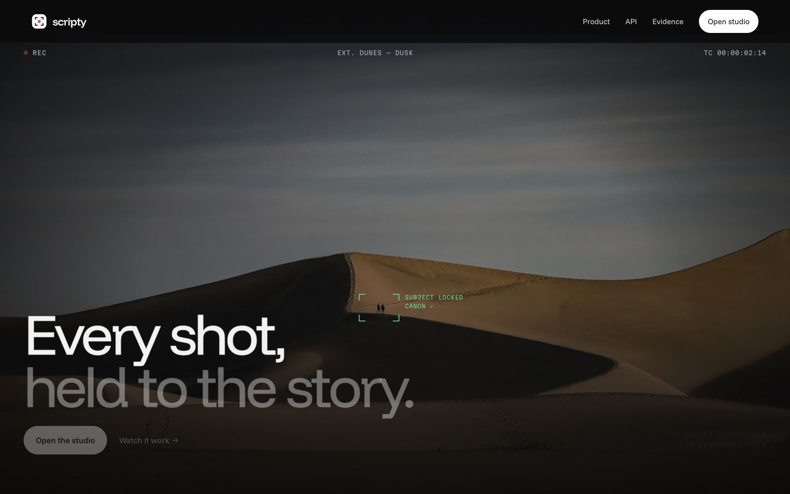
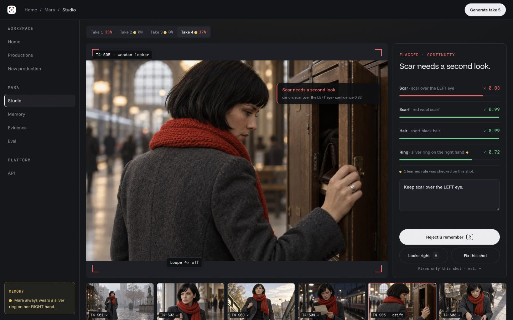
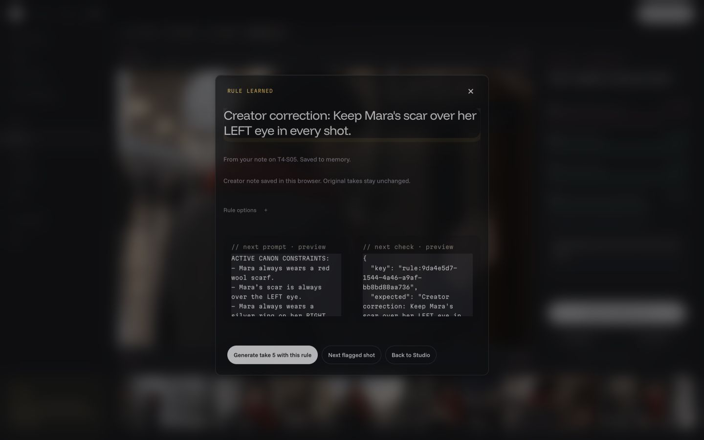
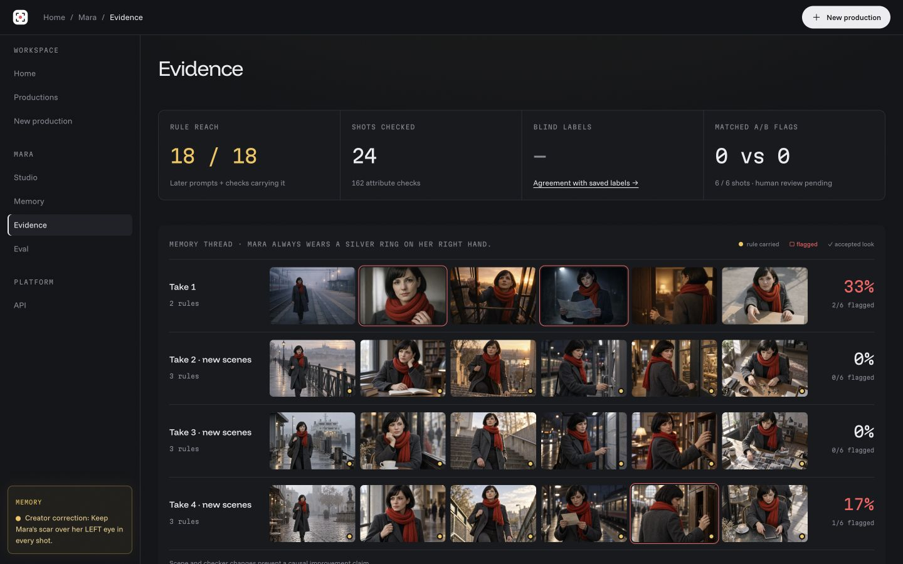

# Scripty — final two-minute demo

App frozen on5e0bb6d. Start at [getscripty.vercel.app](https://getscripty.vercel.app/). Record screen and voice together; read this from a phone outside the captured area. The final upload URL is pending from the founder. Use the current controls below; older review-queue scripts describe a superseded interface.

## Before recording

Use a fresh private tab at desktop width. Start recording before loading the landing if you want the opening title. The top-right **Open studio** opens Home; the hero’s **Open the studio** opens Mara directly. This route uses the top-right button so the productions table is shown. Do not invoke Generate, Re-check or Fix during the two-minute recording.

## Read aloud

On a film set, the scripty keeps continuity straight. AI filmmakers need that memory too: a successful generation can still produce the wrong character.

Scripty brings productions and their shots into one workspace. Mara is our sample: twenty-four real images across four takes.

Here, the monitor flags a possible scar-side mismatch. Its confidence is a model judgment; the creator decides.

I reject the shot with one precise correction. That note becomes a saved rule. In this sample, new notes stay in this browser; original production history stays unchanged.

The rule has two jobs: constrain future generation and become a future monitoring check. That is our learning mechanism: production memory changes subsequent behavior while foundation-model weights stay fixed.

Here is recorded evidence from an earlier ring correction: it reached eighteen later prompts and eighteen checks. All four original takes remain visible, including remaining drift. Our matched six-pair comparison found zero flagged shots in both conditions, so we do not claim measured visual improvement.

Creators can start their own production with a reference, confirmed canon and new scenes. Our first buyers would be small AI production teams; seats plus checked-generation usage is the pricing hypothesis.

Scripty. Every correction carries forward.

## Exact clicks — do not read aloud

| Time | Click/show |
| --- | --- |
|0:00–0:12|Landing opening and headline, then top-right **Open studio**.|
|0:12–0:25|Home productions table and real contact sheet. Click **Mara** in the table.|
|0:25–0:40|Choose **Take4** and **T4·S05**, the locker shot. Point to the scar finding.|
|0:40–1:00|Replace the note with **Keep Mara’s scar over her LEFT eye in every shot.** Click **Reject & remember**.|
|1:00–1:15|Hold on **Rule learned**, its returned text and next-prompt/check previews. If it says merged, explain that repeated constraints merge. Close the card with **×**.|
|1:15–1:45|Sidebar **Evidence**. Point to18/18, all four original takes and0vs0matchedA/B. The historical18/18belongs to the earlier ring rule, not the new scar note.|
|1:45–2:00|Click **New production**. Show the reference upload, confirmed-canon and scene fields. Finish before generating.|

## Visual cues

## Submission

Upload the finished recording to an accepted video host, verify playback without login, and paste the hosted URL into Devpost’s **Video demo link**. The confirmed deadline is October17,2026 at11:00am PDT. Only the founder authorizes the final external submission.
