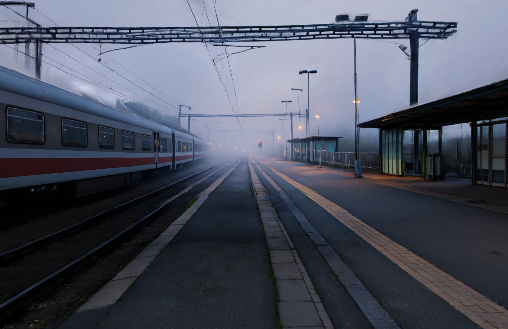

# World Labs Marble for Scripty: location memory

Research date: October 17, 2026, Pacific Time. Scope: research and standalone spike only. Read `AGENTS.md` and `design/claude/DESIGN_HANDOFF.md` before implementation. The user's explicit two-path ownership and paid-spike authorization override the older overnight restrictions in AGENTS. No application integration is included.

## Decision

**Treat an approved Marble world as location canon: a persistent set that provides repeatable reference views.** Scripty already remembers character constraints; location memory would give it a stable environment to refer back to. A generated scene should receive both its character reference and a selected set still. The monitor should compare the resulting environment with that still and visible location constraints.

This is a product proposal, not a verified improvement result. A static 3D set can supply consistent plates; a downstream image generator can still alter them. We have not demonstrated reduced environment drift, correct hidden geometry, character preservation, or calibrated environment checks.

**Before 6:15am PT:** keep the main generation/review loop stable. Finish and show the standalone location experiment. If Main has spare time after core verification, add only a read-only location card using a real captured still and the returned Marble link. Do not add live world generation to the app's batch request. **For the 2:00pm PT deadline:** implement reference injection only if the existing app is already stable and the captured plate has been reviewed. Stop expansion by6:15am; leave the founder time for recording and submission. These times and effort estimates are engineering judgments, not vendor facts.

## Verified API facts

The research covered all API pages listed in the official [documentation index](https://docs.worldlabs.ai/llms.txt), including the full quickstart, examples, models, resource overviews, endpoint references, OpenAPI schema, pricing, limits, errors, FAQ, SPZ rendering, and interactive examples. Sources are linked at the relevant claim below. The full documentation was fetched from the official `llms-full.txt`, with API sections read in full; no key was involved in research.

Base URL: `https://api.worldlabs.ai`. Authentication is the server-side `WLT-Api-Key` header. [OpenAPI/reference](https://docs.worldlabs.ai/api/reference/openapi)

| Method + path (under `/marble/v1`) | Purpose and input/output |
|---|---|
| `POST /media-assets:prepare_upload` | Input `file_name`, `kind` (`image`/`video`), `extension`, optional metadata. Returns media asset plus signed upload URL, HTTP method, required headers. Upload the bytes to that URL, then reference the asset ID. |
| `GET /media-assets/{media_asset_id}` | Retrieve uploaded-media metadata. |
| `POST /worlds:generate` | Start generation from `world_prompt`; optional display name, model, tags, seed, permissions. Returns an operation. |
| `GET /operations/{operation_id}` | Read `done`, error, metadata, response, and settled cost when available. |
| `GET /worlds/{world_id}` | Fetch current world details and asset URLs. |
| `POST /worlds:list` | Paginated API-generated worlds; filter model, status, tags, visibility, dates. |
| `POST /worlds/{world_id}:export` | Export cached PLY splats or start a separately charged HQ GLB mesh job. |
| `DELETE /worlds/{world_id}` | Permanently delete the owned world and assets. Not used by this spike. |
| `POST /pano:depth_to_rgb` | Generate an RGB panorama from a depth panorama and text; asynchronous operation. |
| `GET /credits` | Current aggregate API balance as `remaining_credits`. |

Endpoint sources: [media upload](https://docs.worldlabs.ai/api/reference/media-assets/prepare-upload), [media lookup](https://docs.worldlabs.ai/api/reference/media-assets/get), [world generation](https://docs.worldlabs.ai/api/reference/worlds/generate), [world retrieval](https://docs.worldlabs.ai/api/reference/worlds/get), [list](https://docs.worldlabs.ai/api/reference/worlds/list), [export](https://docs.worldlabs.ai/api/reference/worlds/export), [delete](https://docs.worldlabs.ai/api/reference/worlds/delete), [depth pano](https://docs.worldlabs.ai/api/reference/pano/depth_to_rgb), [credits](https://docs.worldlabs.ai/api/reference/credits/get).

Generation inputs: `type: "text"`, `"image"`, `"multi-image"`, or `"video"`. Images can reference uploaded media, public URIs, or base64 content. An image may be an existing equirectangular pano; `is_pano` defaults to `"auto"`. Set `false` for the seed's ordinary perspective frame. Multi-image inputs support optional azimuth angles. The API supports optional text guidance; omitted image/video captions can be generated automatically. [Generation examples](https://docs.worldlabs.ai/api/world-generation-examples)

The completed world includes `world_marble_url`, caption, `assets.thumbnail_url`, `assets.imagery.pano_url`, SPZ Gaussian splats at `assets.splats.spz_urls` (`100k`, `500k`, `full_res` in examples), scale/ground metadata, and a GLB collider at `assets.mesh.collider_mesh_url`. HQ textured/vertex-colored GLB exports are additional outputs after export. The quickstart estimates about **five minutes** to generate a world; this is an estimate, not an SLA. Its operation snapshot can have null metadata fields; fetch the world for current details. [Quickstart](https://docs.worldlabs.ai/api)

`done: true` alone is insufficient: inspect `error`. `cost.total_credits` and `cost.line_items` are populated on successful operations when public pricing is known; failure/in-progress cost may be null. The spike retains settled cost when returned and labels estimates separately. [Operations](https://docs.worldlabs.ai/api/reference/operations/get)

### Model correction and budget

The requested `marble-1.1-draft` is **not in the current documented models or request enum**. The documented draft is `marble-1.0-draft`; standard is `marble-1.1`. Other listed models are `marble-1.0` and `marble-1.1-plus`. The spike explicitly selects the documented draft then standard; it never probes an undocumented model. The narrative models page and OpenAPI differ on the default, so always send the model explicitly. [Models](https://docs.worldlabs.ai/api/models), [request schema](https://docs.worldlabs.ai/api/reference/openapi)

API credits cost $1 per 1,250. A regular image costs 80 pano credits plus 150 draft credits (=230, $0.184), or plus 1,500 standard credits (=1,580, $1.264). One of each totals **1,810 credits = $1.448**. Media management and operation polling do not consume credits. API billing is separate from Marble subscriptions. The balance check does not itself guarantee a spending cap; the local ledger enforces our two-start limit. No Plus model, HQ mesh export, automatic refill configuration, or purchase is used. [API pricing](https://docs.worldlabs.ai/api/pricing)

Default generation start limits are approximately 3/minute and 60/hour, applied per user/account. On an HTTP error, this spike stops without retries, including 429/5xx. It polls accepted jobs on a bounded schedule and can resume GETs separately. A client timeout does not cancel server work. [Rate limits](https://docs.worldlabs.ai/api/rate-limits), [errors](https://docs.worldlabs.ai/api/errors)

### Spark and coordinates

[Spark](https://github.com/sparkjsdev/spark) is World Labs' Three.js Gaussian splat renderer. It supports SPZ and provides `SparkRenderer`, `SplatMesh`, and a load-completion promise. The viewer pins the official README's Spark **2.3.1** release and Three.js **0.180.0** CDN modules. It uses Three.js OrbitControls and canvas PNG capture. No browser API key is necessary to fetch returned asset URLs; whether our particular URLs support unauthenticated browser loading and capture is a live-test question.

Use returned scale/ground metadata rather than guessed units: `p_metric = raw * metric_scale_factor - (0, ground_plane_offset, 0)`. Apply scale to splat sizes too. Apply renderer axes afterward: Marble's web viewer rotates generated raw OpenCV SPZ by 180° about X. Our hierarchy encodes exactly that order. Missing metadata is labeled unverified. [SPZ rendering guide](https://docs.worldlabs.ai/api/rendering-spz)

## What the film studies actually show

[Creative Film](https://www.worldlabs.ai/case-studies/creative-film) describes Tim Simmons' *Alarm*: scout a stable Marble set, capture plates, composite a separately created character, then animate/edit with other tools. This supports a set-to-still-to-generation workflow; it does not document a Scripty integration or comparative benchmark.

[Framing Worlds](https://www.worldlabs.ai/labs/showcase/framing-worlds) describes the same Tim workflow and Rik Vasquez's reusable environments for episodic work. These are substantially overlapping vendor accounts, not two independent validations. Their relevance is practical: directors can choose views within a persistent world instead of inventing each environment shot by shot. Any claim that this improves our generator/monitor remains unverified until evaluated locally.

## Product options for this deadline

All effort/risk figures below are estimates for Main/Design after this spike, excluding external provider latency.

| Option | User experience | Pros | Cons / risk | Effort; deadline fit |
|---|---|---|---|---|
| **A. Approved location card + captured plate (recommend)** | A location in Memory has a real still, approved constraints, and Open set link. A shot may use that still as an extra reference. Scouting stays in the standalone viewer. | Small surface; persistent location canon; can reuse stored stills during cached demos. | Still upload/storage and reference precedence need verification. Image models can ignore the plate. One still does not establish all geometry. | Read-only card: 30–60 min, low risk. Injection: another 60–120 min, medium risk. Optional before6:15am only after core checks. |
| B. Studio Set view with Spark + per-shot camera | Open Set, orbit, choose shot, capture still, assign angle. | Compelling scouting demo; intentional compositions; future camera reuse. | WebGL/CDN/CORS, camera persistence, upload/assignment state, mobile controls; substantial UI integration. | 3–5 hr, medium/high risk. Standalone spike now; integrated flow defer beyond this release. |
| C. Generate worlds automatically per new location + monitor environments | Create location from script/reference; async generation UI; all shots inherit it and checks. | Broad location memory across a production; closer to full studio workflow. | Queue/polling, partial failures, credit controls, ownership, disambiguating locations, environment evaluation and calibration. | 1–2 days, high risk. Defer. |

The simplest meaningful addition is A. A read-only card demonstrates a real world asset, but must not imply generation/monitor integration until Main implements and tests it. Never make the six-shot demo wait for Marble.

## Design direction (proposal)

In Studio, a **Set** destination can show the world as the main canvas, the selected shot name, Reset camera and Capture still. A successful capture becomes a candidate reference with an explicit **Use for this shot** step; the standalone spike only downloads a PNG. Store a preview alongside the shot so reopening a production does not require a live viewer.

Memory's location card: name (“Foggy railway platform”), real selected still, approved environment rules, Open set. Gold should signal an actually learned/approved memory rule, not merely a generated asset. Keep location controls out of the character review flow unless a shot has an assigned location. Do not revive permanent dashboard rails. Follow the authoritative existing Figma design for the app; the provided Claude handoff informs Studio naming and interactions but AGENTS says final light v3 supersedes older visual layouts.

Per-shot angle metadata should include camera position, quaternion, target, FOV, aspect ratio, coordinate-frame/version, world/version ID and captured image dimensions. Captures with different FOV/aspect are not equivalent composition references. A saved still alone is sufficient for option A; persisted camera editing belongs to option B. Current spike does not persist camera poses.

## Backend fit (proposal grounded in current source)

Read-only inspection found `generateImage` in `lib/generate.ts` currently converts `referenceImageUrl` and `acceptedReferenceUrl` with `imageDataUrl`, and passes the array to both existing providers. `buildFinalPrompt` lives in `lib/rules.ts`; the batch route constructs `finalPrompt` before calling `generateImage`. `lib/monitor.ts` explicitly labels image 1 as character canon and image 2 as the shot, validates every required key, and scores only visible shot evidence. These are code observations, not changes made by this spike.

Proposed minimal additions:

```ts
type Location = {
  id: string; projectId: string; name: string; version: number;
  worldId?: string; worldMarbleUrl?: string;
  thumbnailUrl?: string; panoUrl?: string;
  splatUrls?: Record<string, string>;
  colliderGlbUrl?: string;
  status: "pending" | "ready" | "failed";
  approvedAt?: string; constraints: Attribute[];
};
type LocationView = {
  id: string; locationId: string; worldVersion: number;
  imageUrl: string; width: number; height: number;
  camera?: { position: number[]; quaternion: number[];
    target: number[]; fov: number; aspect: number; frame: string };
};
// Backward-compatible optional fields, not implemented here:
// Shot: locationId?, locationViewId?, locationVersion?, locationChecks?
// Rule: scope?: "character" | "location", locationId?
// Project: locations?: Location[]
```

Persist location/view rows scoped to the production and version the approved world; keep existing projects without locations valid. Use existing private storage/ownership mechanisms for uploaded captured stills. Asset links are external references, not evidence the viewer will remain reachable forever; URL lifetime is unverified. Store a cached still for the demo, not a live dependency. Do not mutate `.env.example`, shared types, migrations or app files from this research agent.

**Generation:** add an optional `locationReferenceUrl` to `generateImage` input and append it to the existing image-conversion pipeline. Preserve the character reference first and its accepted example. The current `buildFinalPrompt` calls all additional images creator-accepted positive references: Main must replace that blanket sentence with explicit role labels so the location plate is never treated as an identity reference. Label location guidance in `finalPrompt`, for example:

> Location canon, version [actual version]: use the selected set still only for environment/composition. Preserve the wet platform, parallel tracks, overhead gantries, lamps and shelter where visible. Preserve the character sheet and current character rules. Do not copy people from the environment plate. Use this location only for shots assigned to it.

Only creator-approved constraints become canon. These seed observations are candidates, not automatically approved rules. The source includes Mara; Marble may bake her into the splat. A prompt to omit people is not a verified removal capability. Inspect the generated set and choose a clear background angle; otherwise skip reference injection. A different station/indoor scene must not inherit this platform.

**Monitor:** add a separately labeled **IMAGE 3 — LOCATION REFERENCE, environment only** after image 2, and optional namespaced requirements such as `location:platform-surface`. Keep image 2 as the only scored image; update the current “two images” instruction intentionally. Check visible contradiction, with `unclear` for occlusion, fog, an off-camera landmark or an unsupported alternate view. Do not compare screen-left of a train across camera angles as a global spatial fact. Whole-world geometric consistency is not established by a vision check of two 2D frames.

Keep `locationChecks` and location flagged rate separate from the fixed character metric until labeled environment examples exist. New location-rule rejections should preserve scope and location/version IDs; never leak a station rule into character canon. Record the location version, captured view ID and applied constraints in the existing trace. A monitor or reference-loading failure must remain unavailable/uncertain, never a fabricated pass. Cached replay retains its provenance.

## Spike files and runbook

Only `experiments/worldlabs/` and this document are owned by this agent. No app integration or other-agent files are modified. Read-only source inspection is used above.

- `make-world.ts`: raw HTTPS upload/generate/poll flow, explicit models, sanitized errors, fixed budget ledger and process lock.
- `result.json`: current status or successful world's normalized fields; retains draft and standard summaries under `runs`.
- `budget.json`: created on a paid start; one reservation per stage. Preserve it even after timeouts/errors.
- `draft-operation.json` / `standard-operation.json`: saved successful API JSON including settled cost; `draft-world.json` / `standard-world.json` store the one follow-up GET response. The real draft operation omitted its pano, while GET world supplied it.
- `viewer.html`: pinned CDN Spark, orbit/pan/dolly/reset, selectable completed stages, download current view as PNG.
- `make-world.test.ts`: budget and no-retry safeguards, model/ID normalization, sanitized failures; no paid calls.
- `viewer-fixture.json`: explicitly labeled public Spark butterfly, solely for free renderer QA; never presented as the generated station.

From `/Users/alexandracowan/canon` (Node 24, existing `tsx` dependency):

```sh
node --import tsx experiments/worldlabs/make-world.ts --check
node --import tsx --test experiments/worldlabs/make-world.test.ts
node --import tsx experiments/worldlabs/make-world.ts draft
python3 -m http.server 8766 --bind 127.0.0.1 --directory experiments/worldlabs
```

Open `http://127.0.0.1:8766/viewer.html`. Serve only the experiment directory, never the repo root containing `.env.local`. The viewer is standalone and does not call app routes. CDN modules and asset loading still need network access. Alternatively use Load result JSON. After visual review only:

```sh
node --import tsx experiments/worldlabs/make-world.ts standard --draft-usable="Describe the actual reviewed panorama and two usable camera views"
```

No background standard generation occurs. Each network request has a timeout (API 30s, upload 60s); polling sleeps 15s and is bounded by 48 polls and a 12-minute wall-clock deadline. Errors stop immediately. An accepted job can continue server-side after client timeout. Recover an existing saved operation with `... make-world.ts resume draft` (or `standard`); that performs GET polling, not another paid start. If POST outcome is unknown and no operation ID was saved, keep the reservation and investigate through the platform; do not repeat it. A stale `.run.lock` requires checking there is no running process before removing only that lock. Do not delete/reset the budget ledger.

The script accepts both `media_asset_id` / `id` and `world_id` / `id`, because current schema and quickstart examples differ. It sends the returned signed-upload method and headers exactly, without forwarding the API key to storage. A short upload filename avoids the schema's 64-character limit despite the long seed hash filename. World permissions stay private; a Marble URL can require the creator's login. Public-link access is not guaranteed by generation.

## Live results and verification

Initial preflight found the seed and no World Labs key, so generation was paused as requested. The user subsequently supplied the key and explicitly authorized execution. The draft completed with world ID `d7e28850-0064-48f1-8b3d-e4210ec4ea02`, settled cost 230 credits ($0.184), and API timestamps indicating 28 seconds from created to updated. Its panorama and two actual Spark camera views were inspected. It preserves a recognizable station layout but bakes Mara into the static scene; close details are soft. Scale metadata remained null even after GET world. The viewer successfully downloaded `draft-camera-view.png`. The standard completed with world ID `f5a75d9d-c071-4a91-a167-e92d192d8858`, settled cost 1,580 credits ($1.264). Its world timestamps span 5 minutes 42 seconds. **Total settled usage: 1,810 credits ($1.448), exactly one draft and one standard.**

| Run | Marble | Settled credits | USD |
|---|---|---:|---:|
| Draft | [Open draft](https://marble.worldlabs.ai/world/d7e28850-0064-48f1-8b3d-e4210ec4ea02) | 230 | $0.184 |
| Standard | [Open standard](https://marble.worldlabs.ai/world/f5a75d9d-c071-4a91-a167-e92d192d8858) | 1,580 | $1.264 |

Verified on the standard: its 500k SPZ loads in pinned Spark; orbit produces a second view of the same train/gantries; canvas capture downloads nonempty PNGs. GET world supplies the panorama, thumbnail, collider GLB URL and three SPZ URLs. Standard metadata returned `metric_scale_factor=2.7923693656921387`, `ground_plane_offset=1.5571990013122559`; the viewer applies both before axis conversion. The initial inspected standard view contains no visible person, even though the generated panorama still includes Mara. Do not infer universal person removal or character editing from this observation.

Real proof assets: `standard-camera-view.png` (platform/track view), `standard-camera-train.png` (alternate train view), `standard-pano.png`, `standard-thumbnail.webp`, plus corresponding draft assets. The standard gives clearer useful frames than the draft in the inspected views; this is a qualitative assessment, not a benchmark. No image-generator integration, environment monitor test or downstream continuity improvement was performed. No live result claim is inferred from the public renderer fixture.



Validation: four standalone safeguard tests pass; strict standalone TypeScript check passes; viewer module syntax and pinned URLs pass static checks; browser verifies real SPZ rendering, orbit, reset and actual PNG download. At 390px, document scroll width equals viewport width (no horizontal overflow) and action buttons are 44px high. Missing-world state disables capture. Generated text outputs were scanned against the actual env key with no secret found; the key was never printed. Marble worlds remain private; their links may require the owning account. Whole-app build is intentionally left to Main because it writes outside this agent's two owned paths and the application is being changed concurrently.

## Ready-to-paste handoff prompts

### Main (backend)

> Read docs/worldlabs.md and experiments/worldlabs/result.json. A real standard world and two captured PNGs are ready; total settled spike usage is $1.448. Preserve the working character demo before6:15am; do not put Marble generation into /api/batch. If time remains after core verification, implement optional locationReferenceUrl through generateImage's existing multi-reference path, plus approved location constraints in buildFinalPrompt. Scope the location/view/version to an explicitly assigned shot; keep character reference priority, cached fallback and trace provenance. Existing productions without locations must behave identically. Defer environment monitoring until image 3 can be explicitly labeled as environment-only with separate location checks and metrics. Use a reviewed captured PNG, not a panorama or a thumbnail as a fake per-shot camera reference. The research agent has not integrated or proven downstream drift reduction. Budget is limited to the spike's one draft and one standard, already tracked in experiments/worldlabs/budget.json; do not generate another world. Validate reference persistence, ownership, no-location compatibility and the full current demo before deploying.

### Design thread (UI)

> Read docs/worldlabs.md and the real spike result; standard-camera-view.png is a verified capture of the live standard SPZ. For before6:15am, prioritize the current demo; the only optional addition is a small Location card in the existing Memory drawer with a reviewed captured still, real location name and Open set link. Do not imply location checking or reference injection exists until Main confirms it. For a later Studio concept, design a Set destination with a Spark canvas, selected shot, orbit/reset, Capture still, and explicit Use for this shot confirmation; keep world loading/error and mobile states, image preview and keyboard focus. Use the existing authoritative design system. Avoid new permanent rails, invented success metrics and generated-world-as-learned gold styling. The standalone experiments/worldlabs/viewer.html already scouts/captures; it downloads a PNG but does not assign one inside Scripty. Do not integrate the full Set view before the final handoff unless Main has completed and verified the core flow.
